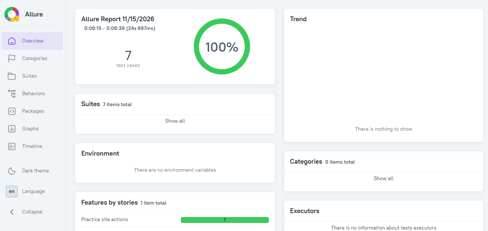
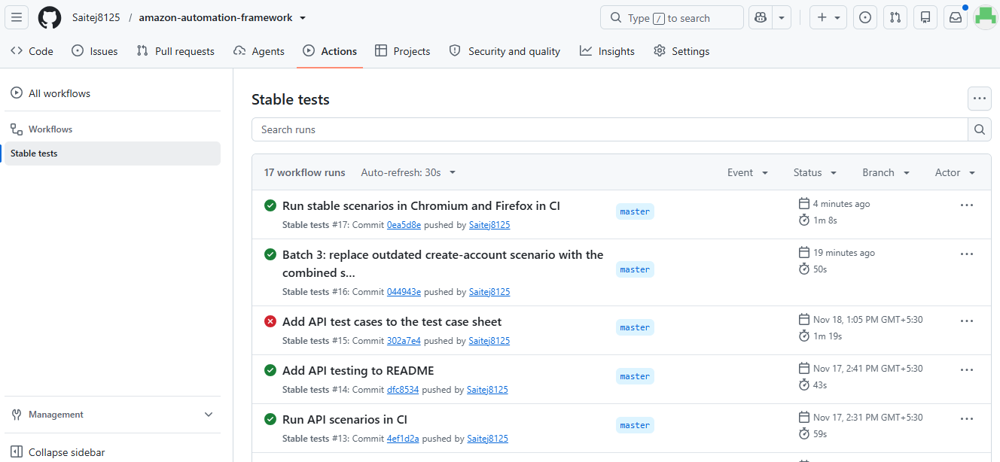

# Amazon.in Test Automation Framework


A test automation project built to practise the full QA workflow on a real e-commerce site: test design, BDD automation, reporting and CI.

**Stack:** Playwright, TypeScript, Cucumber (Gherkin), Page Object Model, JSON test data, Allure reports, GitHub Actions.

## What this project covers

| Area | What is included |
|---|---|
| Test design | 116 test cases across 10 modules in Excel, with priority, severity, test type (smoke, sanity, regression, functional, negative, exploratory, retesting), a summary dashboard and a defect log |
| Automation | 24 Cucumber scenarios: home, search (including a Scenario Outline and negative cases), product, cart, navigation (hover, hover and select, nested menu), filters (multi-select, sorting), and a practice-site module |
| Web actions | XPath, CSS and `getBy*` locators, keyboard and mouse actions, hover, checkboxes, dropdowns, multi-select, new tabs and windows, frames and nested frames, alerts, right-click, drag and drop |
| Reporting | Allure report with step details, severity labels, a screenshot on failure and a video of every scenario |
| CI | GitHub Actions runs the stable practice-site scenarios on every push |

## Test strategy

- **Amazon.in scenarios** run locally and occasionally. Amazon is a live production site with bot protection, so repeated automated runs can be blocked and results can vary between runs. Flaky or blocked cases are recorded honestly in the test case sheet, with dates and reasons.
- **Practice-site scenarios** (`@practice`) use the-internet.herokuapp.com. They are stable, so they run in CI.
- The final payment step is never automated.

| Tag | Meaning |
|---|---|
| `@smoke` | Critical-path checks only |
| `@regression` | Broader set to re-run after changes |
| `@search`, `@navigation`, `@filters` | Module tags |
| `@negative` | Invalid-input cases |
| `@practice` | Practice-site actions, run in CI |
| `@TC_xxx_nnn` | Links a scenario to a row in the test case sheet |
| `@severity:minor` | Becomes the severity label in the Allure report |

## Project structure

```
features/            Gherkin feature files
step-definitions/    TypeScript steps behind each Gherkin line
support/             World (shared state) and hooks (browser, screenshots, video)
pages/               Page Objects: Home, SearchResults, Product, Navigation, Filters, Practice
test-data/           JSON test data
test-cases/          Excel test case sheet, matrix dashboard and defect log
tests/               Earlier Playwright-native specs (locators, smoke, product)
.github/workflows/   CI pipeline
```

## Running locally

Requirements: Node.js 18 or higher, and Java (needed by the Allure command line).

```bash
npm install
npx playwright install chromium

npx cucumber-js --tags "@practice"
npx cucumber-js --tags "@smoke"
npx cucumber-js features/search.feature
npx cucumber-js --dry-run
```

On Windows PowerShell, keep the quotes around tag expressions.

Build and open the Allure report:

```bash
npx allure generate allure-results --clean -o allure-report
npx allure open allure-report
```

## Design notes

- **Page Object Model:** locators and actions live in `pages/`; steps stay short and readable.
- **Fresh browser context per scenario:** each scenario starts as a new guest with an empty cart.
- **Data-driven tests:** Scenario Outlines and JSON data for search keywords and negative inputs.
- **Resilient locators:** scoped to visible containers where Amazon repeats ids or hides duplicate elements.
- **Flaky-test handling:** retry of the home page load, fallback when a product has no Add to Cart button, sponsored results excluded from price checks, and clear error messages that include the page title and URL.

## Screenshots

<!-- After adding the images to a docs/ folder, remove these comment markers. -->
<!--  -->
<!--  -->

## Author

Sai Teja Pasthula, QA Automation Engineer
